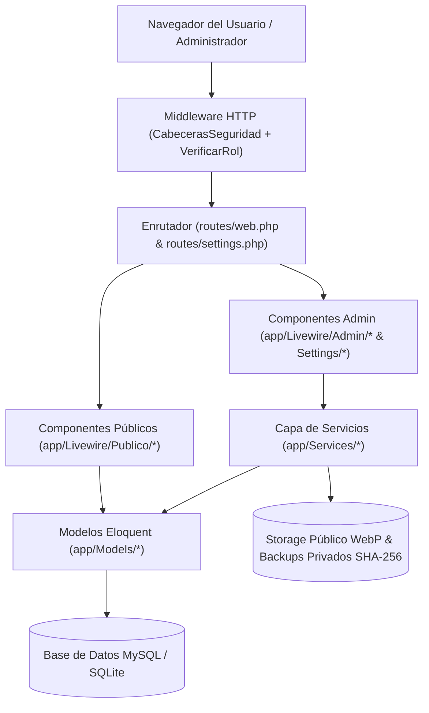

# Manual de Estudio y Arquitectura Completa — RE/MAX Zona Inmobiliaria

> [!IMPORTANT]
> Este documento ha sido generado también en **formato PDF listo para imprimir y estudiar** en:
> - **[Descargar / Abrir PDF: GUIA_ESTUDIO_ARQUITECTURA_REMAX_ZONA.pdf](file:///C:/Users/ASUS/.gemini/antigravity-cli/brain/a6e5a566-84b5-4643-9f81-6c1ffea0109f/GUIA_ESTUDIO_ARQUITECTURA_REMAX_ZONA.pdf)**
> - **[Copia en el proyecto: documentacion/GUIA_ESTUDIO_ARQUITECTURA_REMAX_ZONA.md](file:///D:/pagina%20web%20remax%20puno/documentacion/GUIA_ESTUDIO_ARQUITECTURA_REMAX_ZONA.md)**

---

## 1. Visión General y Stack Tecnológico

El sistema web **RE/MAX Zona Inmobiliaria** es una plataforma inmobiliaria dinámica construida con **Laravel 13 (PHP 8.3/8.4)** y **Livewire 4**. A diferencia de una web estática, integra dos entornos conectados en tiempo real a la misma base de datos:

1. **Sitio Web Público Institucional e Inmobiliario:** Para clientes que buscan comprar, vender o alquilar propiedades en **Arequipa, Lima, Moquegua y Puno**, conocer el *Ranking Top 3 de Vendedores del Mes*, explorar el *Directorio Institucional de Agentes* y contactar por WhatsApp o teléfono.
2. **Panel Administrativo Basado en Roles (`/admin`):** Sistema interno con bloqueo anti-fuerza bruta, **Autenticación de Dos Factores (2FA con código QR)**, Modo Claro/Oscuro y control de permisos para los roles `ADMINISTRADOR` (control total de los 9 módulos) y `MARKETING` (módulos comerciales: Propiedades, Agentes y Ranking Mensual).

---

## 2. Mapa de Directorios: ¿Dónde está cada componente y qué función cumple?

| Carpeta / Archivo | Función dentro de la página web |
|---|---|
| [app/Livewire/Publico/](file:///D:/pagina%20web%20remax%20puno/app/Livewire/Publico) | Lógica PHP de las **6 páginas públicas**: `PaginaInicio`, `PaginaEmpresa`, `PaginaPropiedades`, `PaginaOficinas`, `PaginaPropiedadesOficina` y `PaginaContacto`. |
| [app/Livewire/Admin/](file:///D:/pagina%20web%20remax%20puno/app/Livewire/Admin) | Lógica PHP de los **9 módulos del Panel Administrativo**: `GestionPropiedades`, `GestionAgentes`, `GestionRankingActual`, `HistorialRankings`, `GestionOficinas`, `GestionPortada`, `GestionContacto`, `GestionUsuarios` y `GestionVendedores`. |
| [app/Livewire/Autenticacion/](file:///D:/pagina%20web%20remax%20puno/app/Livewire/Autenticacion) | [IniciarSesion.php](file:///D:/pagina%20web%20remax%20puno/app/Livewire/Autenticacion/IniciarSesion.php) (login con `RateLimiter` de 5 intentos y desafío 2FA) y [ConfirmarPassword.php](file:///D:/pagina%20web%20remax%20puno/app/Livewire/Autenticacion/ConfirmarPassword.php). |
| [app/Livewire/Settings/](file:///D:/pagina%20web%20remax%20puno/app/Livewire/Settings) | Configuración personal de la cuenta: [Profile.php](file:///D:/pagina%20web%20remax%20puno/app/Livewire/Settings/Profile.php) (nombre/correo), [Appearance.php](file:///D:/pagina%20web%20remax%20puno/app/Livewire/Settings/Appearance.php) (Modo Claro/Oscuro) y [Security.php](file:///D:/pagina%20web%20remax%20puno/app/Livewire/Settings/Security.php) (contraseña y 2FA). |
| [app/Models/](file:///D:/pagina%20web%20remax%20puno/app/Models) | Los **Modelos Eloquent** que representan cada tabla de la base de datos y contienen las reglas de dominio, precios formateados y enlaces de WhatsApp. |
| [app/Services/](file:///D:/pagina%20web%20remax%20puno/app/Services) | Los **4 Servicios de Negocio**: [ServicioRankingMensual.php](file:///D:/pagina%20web%20remax%20puno/app/Services/ServicioRankingMensual.php), [ServicioOptimizacionImagen.php](file:///D:/pagina%20web%20remax%20puno/app/Services/ServicioOptimizacionImagen.php), [ServicioRespaldo.php](file:///D:/pagina%20web%20remax%20puno/app/Services/ServicioRespaldo.php) y [ServicioDisponibilidad.php](file:///D:/pagina%20web%20remax%20puno/app/Services/ServicioDisponibilidad.php). |
| [app/Http/Middleware/](file:///D:/pagina%20web%20remax%20puno/app/Http/Middleware) | [VerificarRol.php](file:///D:/pagina%20web%20remax%20puno/app/Http/Middleware/VerificarRol.php) (controla permisos `ADMINISTRADOR` y `MARKETING`) y [CabecerasSeguridad.php](file:///D:/pagina%20web%20remax%20puno/app/Http/Middleware/CabecerasSeguridad.php) (protección CSP, HSTS, X-Frame-Options, nosniff). |
| [app/Support/TelefonoPeru.php](file:///D:/pagina%20web%20remax%20puno/app/Support/TelefonoPeru.php) | Clase auxiliar que normaliza teléfonos peruanos al formato `+51 ...` para lectura y `519...` para enlaces `https://wa.me/`. |
| [resources/views/](file:///D:/pagina%20web%20remax%20puno/resources/views) | Plantillas HTML Blade: layouts maestros ([publico.blade.php](file:///D:/pagina%20web%20remax%20puno/resources/views/components/layouts/publico.blade.php) y [admin.blade.php](file:///D:/pagina%20web%20remax%20puno/resources/views/components/layouts/admin.blade.php)), componente [imagen-optimizada.blade.php](file:///D:/pagina%20web%20remax%20puno/resources/views/components/imagen-optimizada.blade.php) y vistas de cada módulo. |
| [routes/web.php](file:///D:/pagina%20web%20remax%20puno/routes/web.php) | Mapa completo de URLs públicas, `/salud`, `/sitemap.xml`, autenticación y rutas `/admin/*`. |
| [database/migrations/](file:///D:/pagina%20web%20remax%20puno/database/migrations) | Las **13 migraciones** con la estructura de tablas, índices, restricciones `CHECK` y `TRIGGERS` de inmutabilidad en MySQL. |

---

## 3. Base de Datos y Modelos Eloquent (Las Tablas del Sistema)

| Modelo / Archivo | Tabla en BD | Campos Principales y Reglas Programadas |
|---|---|---|
| [Usuario.php](file:///D:/pagina%20web%20remax%20puno/app/Models/Usuario.php) | `usuarios` | `nombre`, `correo` (único), `password` (hashed), `rol` (`ADMINISTRADOR` \| `MARKETING`), `activo`, `tema` (`claro` \| `oscuro`), campos 2FA (`two_factor_secret`, `two_factor_recovery_codes`, `two_factor_confirmed_at`). Métodos: `esAdministrador()`, `esMarketing()`, `usaTemaOscuro()`. |
| [Propiedad.php](file:///D:/pagina%20web%20remax%20puno/app/Models/Propiedad.php) | `propiedades` | `nombre`, `imagen`, `ubicacion`, `oficina` (`AREQUIPA`, `LIMA`, `MOQUEGUA`, `PUNO`), `precio`, `moneda` (`PEN` \| `USD`), `enlace_remax`, `activo`, `destacada`. Calcula `precio_formateado` (`S/` o `$`) y construye el esquema SEO JSON-LD `ItemList`. |
| [Oficina.php](file:///D:/pagina%20web%20remax%20puno/app/Models/Oficina.php) | `oficinas` | `codigo` y `slug` únicos para las **4 sedes oficiales fijas** (`AREQUIPA`/`arequipa`, `LIMA`/`lima`, `MOQUEGUA`/`moquegua`, `PUNO`/`puno`), `nombre`, `direccion`, `telefono`, `whatsapp`, `correo`, `horario`, `enlace_google_maps`, `imagen`. Su método `booted()` prohíbe crear una 5.ª sede, alterar el código/slug o borrar cualquiera de las 4 sedes. |
| [Agente.php](file:///D:/pagina%20web%20remax%20puno/app/Models/Agente.php) | `agentes` | `nombres`, `apellidos`, `fotografia`, `biografia`, `celular`, `whatsapp`, `correo`, `activo`. Genera enlaces directos `tel:`, `https://wa.me/51...` y `mailto:` para el Directorio Institucional. |
| [RankingMensual.php](file:///D:/pagina%20web%20remax%20puno/app/Models/RankingMensual.php) | `rankings_mensuales` | `mes_desempeno`, `anio_desempeno`, `mes_publicacion`, `anio_publicacion`, `estado` (`BORRADOR`, `PUBLICADO`, `CERRADO`, `VENCIDO`), `fecha_publicacion`, `fecha_cierre`, `creado_por`, `actualizado_por`. **Regla crítica (`dentroDePlazoDeGestion`):** solo permite crear, editar o publicar durante los **días 1, 2 y 3 del mes de publicación** (hora `America/Lima`). |
| [PosicionRanking.php](file:///D:/pagina%20web%20remax%20puno/app/Models/PosicionRanking.php) | `posiciones_ranking` | `ranking_mensual_id`, `puesto` (1, 2 o 3), `codigo_interno` (`PART-...`), `nombres_snapshot`, `apellidos_snapshot`, `celular_snapshot`, `celular_normalizado`, `foto_snapshot`. Guarda datos congelados (*snapshot*) por periodo para que el historial jamás se altere. |
| [ConfiguracionContacto.php](file:///D:/pagina%20web%20remax%20puno/app/Models/ConfiguracionContacto.php) | `configuracion_contacto` | **Tabla Singleton (`id = 1`)**. Guarda `nombre_empresa`, `telefono_visible`, `whatsapp_general`, `correo_contacto`, `direccion`, `horario_lunes_viernes`, `horario_sabados`, `whatsapp_postulacion`. |
| [ConfiguracionPortada.php](file:///D:/pagina%20web%20remax%20puno/app/Models/ConfiguracionPortada.php) | `configuracion_portada` | **Tabla Singleton (`id = 1`)**. Guarda la ruta de la fotografía del Hero principal de Inicio (con fallback a `images/fondoejemplo.jpg`). |

---

## 4. Explicación de Cada Página del Sitio Público

1. **Layout Maestro Público ([publico.blade.php](file:///D:/pagina%20web%20remax%20puno/resources/views/components/layouts/publico.blade.php)):**
   - Renderiza metadatos SEO dinámicos, etiquetas Open Graph, Twitter Cards y el esquema JSON-LD `RealEstateAgent`.
   - Incluye el enlace de accesibilidad *Saltar al contenido*, la barra superior con las 5 secciones, el pie de página dinámico y el botón flotante de WhatsApp.
2. **Página de Inicio (`GET /` — [PaginaInicio.php](file:///D:/pagina%20web%20remax%20puno/app/Livewire/Publico/PaginaInicio.php)):**
   - **Banner Hero:** Muestra la imagen de `ConfiguracionPortada` optimizada en WebP con `fetchpriority="high"`.
   - **Nuestros Destacados (Top 3 del Mes):** Consulta en modo solo lectura si el ranking del mes actual está `PUBLICADO` o `CERRADO`. Si tiene sus 3 puestos, muestra las tarjetas de **1.er, 2.º y 3.er Puesto** con foto y botón de WhatsApp; si no, muestra el aviso *"Ranking mensual en actualización..."*.
   - **Propiedades Destacadas:** Lista todas las propiedades con `activo = true` y `destacada = true`.
   - **CTA Trabaja con nosotros:** Enlace directo al WhatsApp de postulaciones.
3. **Página Empresa (`GET /empresa` — [PaginaEmpresa.php](file:///D:/pagina%20web%20remax%20puno/app/Livewire/Publico/PaginaEmpresa.php)):**
   - Muestra la sección *Quiénes somos* (con foto de premios), *Identidad corporativa* (Misión, Visión y Valores), el *Ranking Top 3 del mes* y el **Directorio Institucional de Agentes Inmobiliarios** (todos los agentes con `activo = true` y sus botones de Celular, WhatsApp y Correo).
4. **Página Propiedades — Catálogo General (`GET /propiedades` — [PaginaPropiedades.php](file:///D:/pagina%20web%20remax%20puno/app/Livewire/Publico/PaginaPropiedades.php)):**
   - Incluye tres filtros reactivos en vivo sincronizados con la URL (`#[Url]`): búsqueda por texto (`nombre` o `ubicacion` con debounce de 300ms), selector dinámico de ubicaciones disponibles y selector de moneda (`PEN` o `USD`), además del botón *Limpiar filtros*.
5. **Página Oficinas (`GET /oficinas` — [PaginaOficinas.php](file:///D:/pagina%20web%20remax%20puno/app/Livewire/Publico/PaginaOficinas.php)):**
   - Muestra las tarjetas de las 4 sedes oficiales (**Arequipa, Lima, Moquegua y Puno**) con su foto (o placeholder institucional), dirección, teléfonos, horario, enlace a Google Maps y el botón **"Ver propiedades"** hacia su catálogo exclusivo.
6. **Página Propiedades por Oficina (`GET /oficinas/{oficina}` — [PaginaPropiedadesOficina.php](file:///D:/pagina%20web%20remax%20puno/app/Livewire/Publico/PaginaPropiedadesOficina.php)):**
   - Valida que `{oficina}` sea `arequipa`, `lima`, `moquegua` o `puno` (si no, devuelve `404`). Muestra el resumen de contacto de esa sede y un catálogo con buscador en vivo filtrado exclusivamente para los inmuebles de esa oficina.
7. **Página Contacto (`GET /contacto` — [PaginaContacto.php](file:///D:/pagina%20web%20remax%20puno/app/Livewire/Publico/PaginaContacto.php)):**
   - Presenta en 4 tarjetas los canales oficiales de atención y horarios de `ConfiguracionContacto`.

---

## 5. Explicación de Cada Módulo del Panel Administrativo (`/admin`)

| Módulo | Ruta | Rol Permitido | Archivo Componente y Función Exacta |
|---|---|---|---|
| **Login + 2FA** | `/admin/login` | Invitados (`guest`) | [IniciarSesion.php](file:///D:/pagina%20web%20remax%20puno/app/Livewire/Autenticacion/IniciarSesion.php): Valida credenciales con bloqueo de 5 intentos por minuto (`RateLimiter`), verifica que `activo = true` y solicita código TOTP de 6 dígitos o código de recuperación si el usuario tiene 2FA activo. |
| **Propiedades** | `/admin/propiedades` | `ADMINISTRADOR` y `MARKETING` | [GestionPropiedades.php](file:///D:/pagina%20web%20remax%20puno/app/Livewire/Admin/GestionPropiedades.php): CRUD completo de inmuebles, asignación a una de las 4 oficinas, validación de precio/moneda, subida de foto con conversión automática a WebP (1200px) y botón para marcar/desmarcar como **Destacada**. |
| **Agentes** | `/admin/agentes` | `ADMINISTRADOR` y `MARKETING` | [GestionAgentes.php](file:///D:/pagina%20web%20remax%20puno/app/Livewire/Admin/GestionAgentes.php): CRUD del directorio de agentes con biografía, teléfonos formateados con `+51`, foto WebP (600px) y botón rápido para activar u ocultar agentes del sitio público. |
| **Ranking Mensual** | `/admin/ranking-actual` | `ADMINISTRADOR` y `MARKETING` | [GestionRankingActual.php](file:///D:/pagina%20web%20remax%20puno/app/Livewire/Admin/GestionRankingActual.php) y [ServicioRankingMensual.php](file:///D:/pagina%20web%20remax%20puno/app/Services/ServicioRankingMensual.php): Sincroniza estados vencidos/cerrados, habilita la edición solo los días **1, 2 y 3 del mes**, guarda individualmente los puestos 1, 2 y 3 validando que no haya celulares duplicados, advierte posibles homónimos y publica el ranking cuando los 3 puestos están completos. |
| **Portada Principal** | `/admin/portada` | Solo `ADMINISTRADOR` | [GestionPortada.php](file:///D:/pagina%20web%20remax%20puno/app/Livewire/Admin/GestionPortada.php): Actualiza la imagen Hero de la página de Inicio y genera su versión WebP a 1920px. |
| **Oficinas** | `/admin/oficinas` | Solo `ADMINISTRADOR` | [GestionOficinas.php](file:///D:/pagina%20web%20remax%20puno/app/Livewire/Admin/GestionOficinas.php): Selector para editar los datos de contacto, horario, enlace de Google Maps y fotografía (WebP 1000px) de cada una de las 4 sedes oficiales. |
| **Historial Rankings** | `/admin/historial-rankings` | Solo `ADMINISTRADOR` | [HistorialRankings.php](file:///D:/pagina%20web%20remax%20puno/app/Livewire/Admin/HistorialRankings.php): Consulta histórica de solo lectura filtrable por año y mes de desempeño para auditar rankings pasados. |
| **Contacto Global** | `/admin/configuracion-contacto` | Solo `ADMINISTRADOR` | [GestionContacto.php](file:///D:/pagina%20web%20remax%20puno/app/Livewire/Admin/GestionContacto.php): Edición de teléfonos, WhatsApp general, WhatsApp de postulación, correo, dirección y horarios de la empresa. |
| **Usuarios y Roles** | `/admin/usuarios` | Solo `ADMINISTRADOR` | [GestionUsuarios.php](file:///D:/pagina%20web%20remax%20puno/app/Livewire/Admin/GestionUsuarios.php): Creación y edición de usuarios administrativos, asignación de rol y activación/desactivación (con bloqueo para impedir que el admin actual se desactive a sí mismo). |
| **Mi Cuenta y 2FA** | `/settings/profile` `/settings/appearance` `/settings/security` | `ADMINISTRADOR` y `MARKETING` | [Profile.php](file:///D:/pagina%20web%20remax%20puno/app/Livewire/Settings/Profile.php) (nombre y correo), [Appearance.php](file:///D:/pagina%20web%20remax%20puno/app/Livewire/Settings/Appearance.php) (Modo Claro/Oscuro en vivo) y [Security.php](file:///D:/pagina%20web%20remax%20puno/app/Livewire/Settings/Security.php) (cambio de contraseña y activación de 2FA con código QR y códigos de recuperación). |
